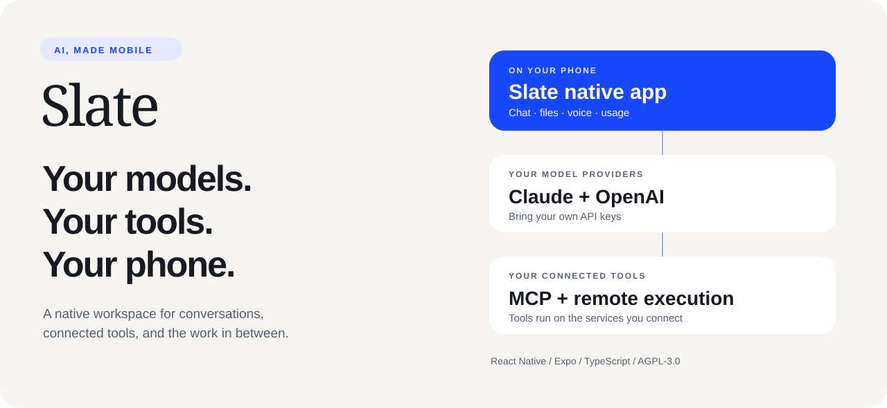

<p align="center">
  
</p>
<h1 align="center">Slate</h1>
<p align="center"><strong>Your models. Your tools. Your phone.</strong></p>
<p align="center">An Android-first AI workspace built with React Native.<br />Chat with Claude and OpenAI, connect MCP tools, and bring your own API keys.</p>
<p align="center">
  <a href="https://github.com/AIM-IT4/slate/releases/download/v1.6.0/Slate-1.6.0.apk">Download Android</a> ·
  <a href="#get-started">Get started</a> ·
  <a href="docs/slate/getting-started.md">Set up your tools</a> ·
  <a href="ROADMAP.md">Roadmap</a> ·
  <a href="CONTRIBUTING.md">Contribute</a>
</p>
<p align="center">
  
  
  
  <a href="LICENSE"></a>
</p>



## AI that fits in your hand

A conversation can be a place to think, write code, inspect a repository, or work with a file. Slate brings those workflows into a mobile interface, with streaming responses, native navigation, and tools you choose.

- **Claude and OpenAI, together.** Configure your providers, pick models, and switch between agents with different instructions and tools.
- **MCP from your phone.** Connect remote HTTPS MCP servers and enable their tools for an agent. Compatible execution servers can run code on a remote machine without an SSH setup.
- **Files and media in the conversation.** View interactive HTML charts, images and supported documents inside chat, with inline audio and video playback.
- **Video, with more context.** The attachment pipeline can combine sampled frames with an on-device Whisper speech transcript. See [media support and limits](docs/slate/getting-started.md#video-and-audio).
- **Usage within reach.** A compact chat tile shows today's recorded tokens and cost. Open the full statistics view for the breakdown.
- **Made for mobile.** Light and dark themes, native share flows, voice features, and reduced-motion support.

Slate is preview software. Model features depend on the selected provider, and connected tools require their own configuration. API and hosting providers may charge for usage.

## Get started

### Use the app

1. Download the signed [Slate 1.6.0 Android ARM64 APK](https://github.com/AIM-IT4/slate/releases/download/v1.6.0/Slate-1.6.0.apk). [Release notes](https://github.com/AIM-IT4/slate/releases/tag/v1.6.0) and [SHA-256 checksum](https://github.com/AIM-IT4/slate/releases/download/v1.6.0/SHA256SUMS) are available on GitHub.
2. Open Slate and add your OpenAI or Anthropic API key under provider settings.
3. Pick a model and start a conversation. Add a remote MCP server when you need tools.

There is no Slate account requirement for the bring-your-own-key chat flow. Your model provider or connected service may require an account.

[Provider and MCP setup →](docs/slate/getting-started.md)

### Build from source

Use **Node.js 24** and **pnpm 12.2.1**. Android development also requires a JDK and the Android SDK.

```bash
git clone https://github.com/AIM-IT4/slate.git
cd slate
pnpm install --frozen-lockfile
pnpm android
```

Slate includes custom native modules, so use a development client rather than Expo Go. Once the client is installed, `pnpm dev` starts Metro.

For an unsigned release APK, native tool versions, and signing with your own key, follow the [Slate build guide](SLATE.md#build). Keep your signing key outside the repository.

## What runs where?

| On your phone | With services you connect |
| --- | --- |
| Native interface, conversation storage, attachments, and usage records | Model inference through your configured provider |
| Device-bound secure storage for provider credentials and MCP headers | MCP tool calls to the server you select |
| On-device Whisper speech transcription for the video attachment workflow | Shell commands and rendering on an execution server |
| Playback of supported video files and links | Video-frame preparation through the current Slate Execution integration |

Adding a coding MCP server does not automatically move the video upload integration to that server. Read [privacy and data flow](docs/slate/privacy.md) before sending private files to a connected service.

## Built in the open

**React Native · Expo · TypeScript · SQLite · MCP · Whisper**

Android ARM64 preview builds are the current distribution target. The inherited iOS source is present, but a Slate iOS release has not been validated or shipped.

| Explore | Start here |
| --- | --- |
| Product direction | [Roadmap](ROADMAP.md) |
| Your first contribution | [Contributing](CONTRIBUTING.md) |
| Native builds and fork details | [Slate technical notes](SLATE.md) |
| Architecture | [Architecture overview](docs/references/architecture-overview.md) |
| Run your own execution service | [Execution service guide](scripts/slate-execution/README.md) |
| Report a bug or propose a feature | [Issue templates](https://github.com/AIM-IT4/slate/issues/new/choose) |
| Report a vulnerability | [Security policy](SECURITY.md) |

Contributions in Android testing, accessibility, documentation, and MCP interoperability are especially welcome. If Slate is useful to you, a star helps other mobile AI builders find it. Reproducible bug reports and thoughtful pull requests help it improve.

## Credits and license

Slate is an independent fork of [Cherry Studio Mobile](https://github.com/CherryHQ/cherry-studio-app), based on version 0.6.3. It is not an official Cherry Studio release. The upstream project and its contributors made this foundation possible.

[GNU Affero General Public License v3.0](LICENSE). Original copyright notices are retained. See [upstream documentation](README.upstream.md) and the [third-party notice index](NOTICE.md) for attribution.
